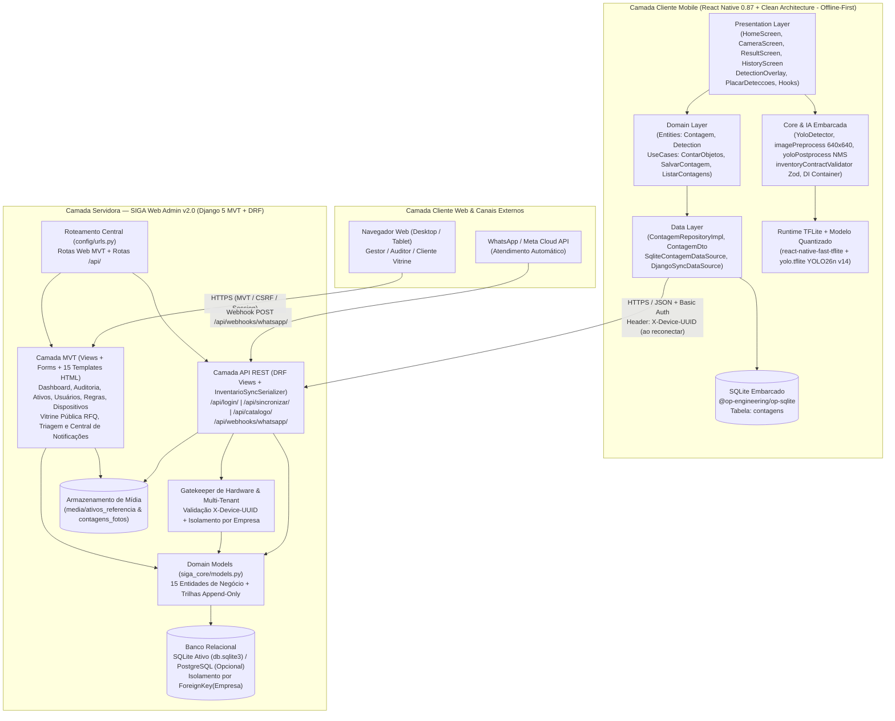
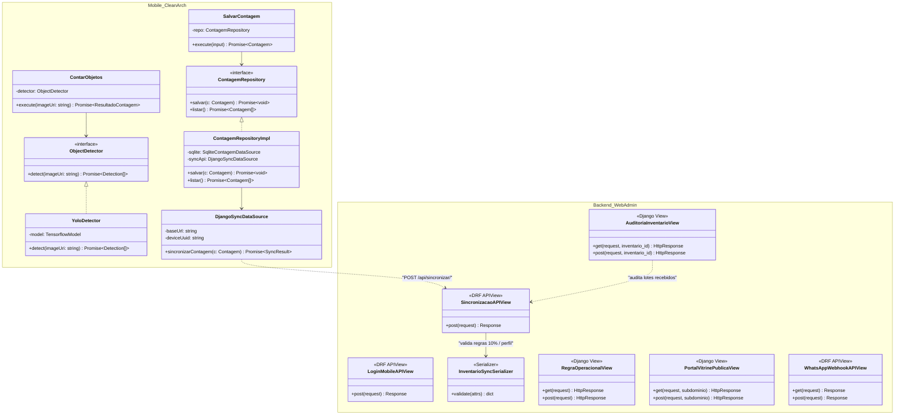

# 3. Arquitetura e Engenharia de Software — Ecossistema SIGA

Este documento detalha a **arquitetura híbrida Cliente-Servidor Offline-First** do ecossistema SIGA (**SIGA Mobile** + **SIGA Web Admin v2.0**), a **stack tecnológica** com justificativas de engenharia e a **modelagem de dados completa** (DER atualizado v2.0 e Diagrama de Classes UML).

---

## 3.1 Arquitetura do Sistema

O SIGA adota uma arquitetura **Cliente-Servidor Desacoplada e Offline-First em Camadas**, na qual:
1. **Camada Cliente Móvel (`frontend/` — React Native + Clean Architecture):** opera de forma totalmente autônoma em campo (sem dependência de rede). Toda a captura, pré-processamento de imagem, inferência de Visão Computacional (`TFLite`), conferência visual e persistência em SQLite ocorrem localmente no smartphone.
2. **Camada Servidora Corporativa (`backend/` — Django 5 MVT + Django REST Framework):** atua como núcleo de governança multi-tenant (`siga_core`), servindo simultaneamente o painel web administrativo e vitrine pública (via arquitetura **MVT — Model-View-Template**) e os endpoints **API REST** para autenticação, catálogo de ativos, sincronização idempotente de inventários e webhook do WhatsApp Bot.

> **Nota sobre evolução do Backend e Persistência:** O repositório preserva em `backend/src/` o protótipo inicial em **FastAPI** criado na Sprint 1 (`#TSK-10`), enquanto a aplicação oficial **SIGA Web Admin v2.0** reside em `backend/config/`, `backend/siga_core/` e `backend/templates/`. Na implementação atual, o sistema opera **100% sobre SQLite (`db.sqlite3`)** com isolamento lógico por coluna (`ForeignKey(Empresa)` no ORM do Django), dispensando o uso de `TenantMiddleware` ou `django-tenants` e suportando integralmente Digest Executivo, Webhook WhatsApp, Vitrine RFQ, `JSONField` e `HistoricoEvento` (mantendo o PostgreSQL via `DB_ENGINE=postgres` apenas como opção futura para alta concorrência em produção).

### Diagrama Simplificado da Arquitetura (Mermaid)

### Fluxo Interno das Camadas no Mobile (Clean Architecture)
* **`src/presentation/`:** Interfaces visuais e hooks (`useContagemFlow`, `useCameraAngle`, `useAppLocation`, `useHistorico`). Nenhuma regra de SQL ou inferência fica acoplada às telas.
* **`src/domain/`:** Contratos e regras puras de domínio (`Contagem`, `Detection`, `ObjectDetector`, `ContagemRepository`, `ContarObjetos`, `SalvarContagem`, `ListarContagens`). O caso de uso `ContarObjetos` converte detecções de `table_joint` em contagem de mesas (`Math.ceil(porClasse.table_joint / 2)`).
* **`src/data/`:** Implementação concreta dos repositórios (`ContagemRepositoryImpl`) e fontes de dados (`SqliteContagemDataSource` para modo offline e `DjangoSyncDataSource` para sincronização com `/api/sincronizar/`).
* **`src/core/`:** Infraestrutura transversal — `database.ts` (migrations versionadas via `PRAGMA user_version`), `YoloDetector.ts`, `imagePreprocess.ts` (*letterbox* `640×640`), `yoloPostprocess.ts` (decoder + NMS por classe), `inventoryContractValidator.ts` (validação Zod do contrato `event_rental_inventory.json`) e `container.ts` (injeção de dependências).

---

## 3.2 Stack Tecnológico e Justificativa das Escolhas

| Camada | Tecnologia / Biblioteca | Versão no Projeto | Justificativa Técnica de Engenharia |
| :--- | :--- | :--- | :--- |
| **Mobile (UI e Core)** | **React Native + TypeScript** | RN `0.87.1` / React `19.2.3` / TS `^6.0.3` | Permite compilação nativa cross-platform (Android ARM64 e iOS) com acesso de baixa latência à câmera, sensores e pontes C++/JSI, evitando gargalos de memória e lentidão de WebViews puras/Cordova. |
| **Câmera e Imagem** | `react-native-vision-camera`, `react-native-image-picker`, `@bam.tech/react-native-image-resizer`, `jpeg-js` | `^5.2.3` / `^8.2.1` / `^3.0.11` / `^0.4.4` | Garante captura com foco/flash, seleção da galeria e redimensionamento proporcional (*letterbox* `640×640`) com limpeza de arquivos temporários em disco para prevenir *Out-Of-Memory (OOM)* em fotos de 12MP–48MP. |
| **Telemetria & UX** | `react-native-sensors`, `@react-native-community/geolocation`, `react-native-reanimated`, `react-native-gesture-handler` | `^7.3.6` / `^3.4.0` / `^4.7.1` / `^3.4.0` | Coleta inclinação da câmera (`pitch`/`roll`) e coordenadas GPS com endereço para auditoria; Reanimated + Gesture Handler entregam *pinch-to-zoom* fluido a 60 FPS sobre os marcadores coloridos. |
| **Visão Computacional** | **YOLO26n (v14)** exportado em **TensorFlow Lite (FP16)** + `react-native-fast-tflite` | `^3.0.1` (`yolo.tflite`) | Arquitetura *single-stage anchor-free* leve, superior ao SSD MobileNet em estruturas vazadas (`Gradil`) e muito mais rápida que Faster R-CNN (>8s). A quantização FP16 gera binário enxuto e inferência local offline abaixo de `1,5s`. |
| **Contrato de IA** | **JSON Schema + Zod** | `zod ^4.6.6` (`schema_version: 2.0.0`) | Desacopla o time de IA do time Mobile: valida estrutura, mapeamento de IDs (`0`–`3`) e prontidão para produção (`configuration_status`) antes de liberar a inferência em builds Release. |
| **Persistência Mobile** | **SQLite** via `@op-engineering/op-sqlite` + `react-native-fs` | `^18.2.5` / `^2.20.0` | Banco relacional embarcado de alta velocidade com migrations versionadas (`PRAGMA user_version`), operando 100% offline e armazenando imagens localmente no diretório privado do app. |
| **Backend & Web Admin** | **Python + Django + Django REST Framework (DRF)** | Django `>=5.0,<5.2` / DRF `>=3.15,<3.16` | Unifica o portal administrativo web (arquitetura MVT com formulários, autenticação, proteção CSRF e ORM) e a API REST para o mobile no mesmo núcleo `siga_core`, acelerando entregas e mantendo consistência transacional (`@transaction.atomic`). |
| **Banco Corporativo** | **SQLite** (`db.sqlite3`) / **PostgreSQL** (`psycopg2-binary`, opcional) | Nativo Django / `>=2.9,<3.0` | O **SQLite** atende integralmente ao MVP e suporta nativamente `UUIDField`, `JSONField` (`detections_json` e `payload`), transações atômicas, Digest Executivo, Webhook WhatsApp, Vitrine RFQ e `HistoricoEvento`, com isolamento lógico via `ForeignKey(Empresa)` sem exigir `TenantMiddleware`. O PostgreSQL permanece configurado opcionalmente (`DB_ENGINE=postgres` em `settings.py`) para cenários futuros de alta escrita simultânea. |
| **Infra & Qualidade** | **Docker / Docker Compose**, **GitHub Actions**, **Git LFS**, **Jest**, **ESLint**, **Django TestCase / Pytest** | Node `22` / Python `3.11` / Jest `^29.6.3` | Padroniza execução local, versiona modelos `.tflite` pesados via LFS e automatiza checagem de lint, sintaxe Python e build iOS `.ipa` a cada push/PR. |

---

## 3.3 Modelagem de Dados (DER Atualizado v2.0 e Diagrama de Classes)

### Visão Geral da Persistência Dupla
* **Persistência na Borda (Mobile SQLite — `frontend/src/core/database/database.ts`):** Tabela única `contagens` versionada por 4 blocos de migrações (`id`, `image_uri`, `total_detectado`, `total_confirmado`, `por_classe` JSON, `modelo_versao`, `criado_em`, `sincronizado`, `justificativa`, `camera_pitch`, `camera_roll`, `latitude`, `longitude`, `endereco`).
* **Persistência Corporativa (Backend Django — `backend/siga_core/models.py`):** Composta por **15 modelos relacionais** organizados em quatro blocos: (1) Multi-Tenancy e RBAC; (2) Regras e Dispositivos Móveis; (3) Catálogo, Inventário e Auditoria; (4) Pilares Corporativos v2.0 (Vitrine RFQ, Notificações e Trilha de Eventos).

### Diagrama Entidade-Relacionamento Completo (DER v2.0 — Implementado)

```mermaid
erDiagram
    Empresa ||--o{ Usuario : "possui"
    Empresa ||--o{ RegraOperacionalMobile : "parametriza"
    Empresa ||--o{ DispositivoMovel : "homologa"
    Empresa ||--o{ ClasseAtivo : "cadastra"
    Empresa ||--o{ Inventario : "consolida"
    Empresa ||--o| ParametrosLocacao : "configura vitrine"
    Empresa ||--o{ SolicitacaoInteresse : "recebe RFQs"
    Empresa ||--o{ NotificacaoInterna : "emite avisos"
    Empresa ||--o{ HistoricoEvento : "registra trilha"

    Usuario ||--o| Funcionario : "especializa (1:1)"
    Usuario ||--o| Terceirizado : "especializa (1:1)"
    Usuario ||--o{ DispositivoMovel : "responsável por"
    Usuario ||--o{ Inventario : "executa"
    Usuario ||--o{ LogAuditoria : "audita"
    Usuario ||--o{ NotificacaoInterna : "destinatário"
    Usuario ||--o{ HistoricoEvento : "autor"

    DispositivoMovel ||--o{ Inventario : "transmite"
    RegraOperacionalMobile ||--o{ Inventario : "rege (Opção 2)"
    Inventario ||--o{ ItemInventario : "contém (Cascade)"
    ClasseAtivo ||--o{ ItemInventario : "classifica"
    Inventario ||--o{ LogAuditoria : "gera pareceres"

    SolicitacaoInteresse ||--o{ ItemSolicitacaoInteresse : "solicita itens"
    ClasseAtivo ||--o{ ItemSolicitacaoInteresse : "referencia"
    SolicitacaoInteresse ||--o{ HistoricoEvento : "vincula eventos"

    Empresa {
        uuid id PK
        string razao_social
        string schema_name UK
        string subdominio UK
        boolean status_ativo
        datetime criado_em
    }

    Usuario {
        uuid id PK
        uuid empresa_id FK
        string username UK
        string email
        string cpf UK
        string tipo_operador "GESTOR | FUNCIONARIO | TERCEIRIZADO"
        boolean status_ativo
    }

    Funcionario {
        uuid usuario_id PK,FK
        string matricula UK
        string departamento
    }

    Terceirizado {
        uuid usuario_id PK,FK
        string empresa_prestadora
        string tipo_contrato "DIARIA | TEMPORARIO | ANUAL"
        int dias_acesso_ano
        date data_fim_contrato
    }

    RegraOperacionalMobile {
        int id PK
        uuid empresa_id FK
        string tipo_operador_alvo "FUNCIONARIO | TERCEIRIZADO"
        decimal limite_edicao_manual_pct "20.0 | 5.0"
        decimal tolerancia_erro_ia_pct "10.0"
        boolean exige_justificativa
        time horario_inicio
        time horario_fim
        int versao
    }

    DispositivoMovel {
        uuid id PK
        uuid empresa_id FK
        uuid usuario_responsavel_id FK
        string uuid_dispositivo UK
        string modelo
        string status_autorizacao "AUTORIZADO | BLOQUEADO | PENDENTE"
        datetime data_registro
        datetime ultima_atuacao
    }

    ClasseAtivo {
        int id PK
        uuid empresa_id FK
        string nome_classe
        string codigo_yolo
        string categoria
        text descricao
        string imagem_referencia
        int limite_minimo_itens
        int limite_maximo_itens
    }

    Inventario {
        uuid id PK
        uuid empresa_id FK
        uuid usuario_id FK
        uuid dispositivo_id FK
        int regra_operacional_id FK
        datetime data_hora_inicio
        datetime data_hora_fim
        string status_auditoria "APROVADO | REJEITADO | EM_ANALISE | DIVERGENTE"
        string lat_long
        datetime criado_em
    }

    ItemInventario {
        uuid id PK
        uuid inventario_id FK
        int classe_ativo_id FK
        int qtd_detectada_ia
        int qtd_confirmada_humano
        text justificativa
        string foto
        json detections_json
    }

    LogAuditoria {
        uuid id PK
        uuid inventario_id FK
        uuid usuario_auditor_id FK
        text parecer
        datetime data_hora
    }

    ParametrosLocacao {
        int id PK
        uuid empresa_id FK,UK
        string regiao
        int dias_antecedencia_min
        int prazo_frete_dias_uteis
        text disclaimer_legal
    }

    SolicitacaoInteresse {
        uuid id PK
        uuid empresa_id FK
        string nome_solicitante
        string documento
        string telefone_whatsapp
        string email_solicitante
        boolean cliente_vip
        string cep_evento
        string endereco_evento
        string localizacao
        date data_inicio_evento
        date data_fim_evento
        string status
        text parecer_logistica
        string token_rastreio
    }

    ItemSolicitacaoInteresse {
        int id PK
        uuid solicitacao_id FK
        int classe_ativo_id FK
        int quantidade_solicitada
    }

    NotificacaoInterna {
        uuid id PK
        uuid empresa_id FK
        uuid destinatario_id FK
        string tipo
        string titulo
        text mensagem
        boolean lida
        datetime criado_em
    }

    HistoricoEvento {
        uuid id PK
        uuid empresa_id FK
        string tipo_origem
        string canal
        uuid solicitacao_vinculada_id FK
        uuid autor_id FK
        string acao
        json payload
        datetime criado_em
    }
```

### Diagrama de Classes UML — Camadas de Aplicação (Mobile + Web Admin)

