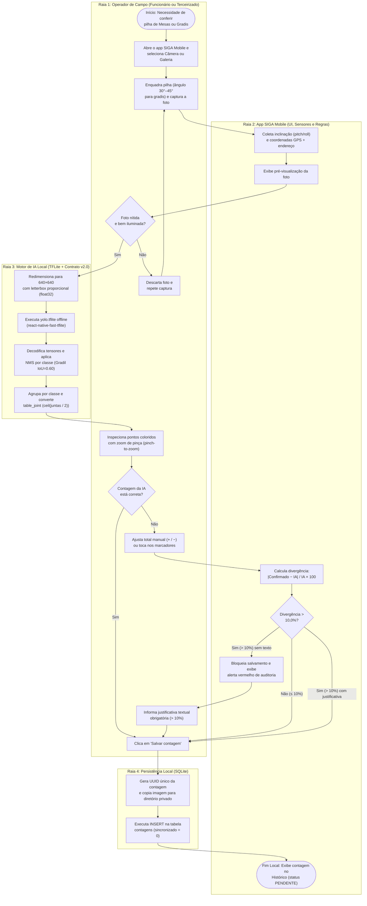
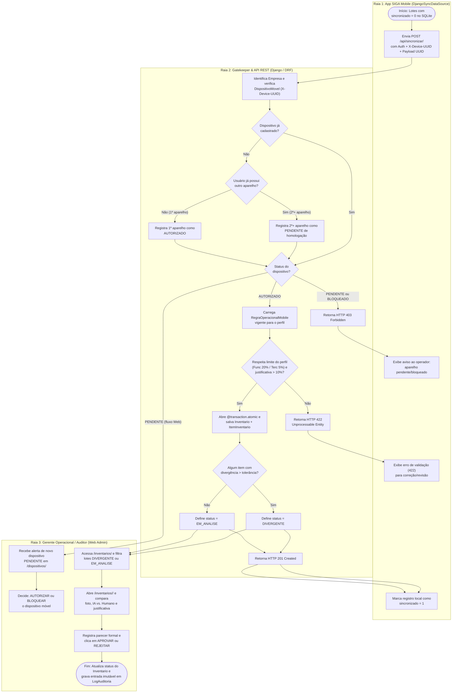
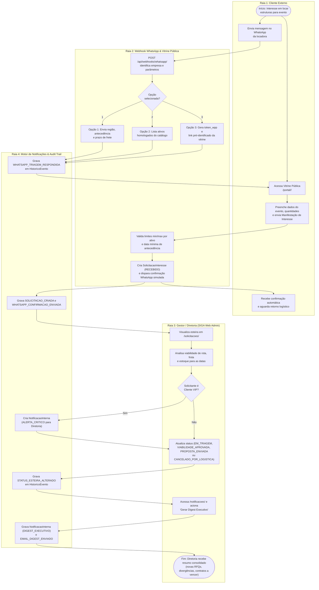

# 2. Diagramas de Processos de Negócio (BPDs) — Ecossistema SIGA

Este documento modela os **três processos de negócio centrais** do ecossistema SIGA utilizando notação de fluxo por raias (*swimlanes*) em Mermaid, cobrindo desde a operação em campo 100% offline no **SIGA Mobile** até a auditoria corporativa, gestão de dispositivos e esteira comercial no **SIGA Web Admin v2.0**.

---

## BPD 01 — Contagem, Conferência e Persistência em Campo (100% Offline)

Descreve o fluxo ponta a ponta executado pelo operador no galpão ou evento sem dependência de conexão com a internet, contemplando telemetria de sensores, inferência TFLite, contagem assistida por articulações (`table_joint`) e trava de auditoria para divergências superiores a `10,0%`.

---

## BPD 02 — Sincronização Assíncrona, Homologação de Hardware e Auditoria Formal

Descreve o processo de envio dos lotes armazenados no SQLite quando o dispositivo recupera conectividade, a validação de segurança do hardware (`X-Device-UUID`), a aplicação das regras operacionais versionadas por perfil e a auditoria visual imutável no **SIGA Web Admin**.

---

## BPD 03 — Manifestação de Interesse (Vitrine RFQ), WhatsApp Bot e Digest Executivo

Descreve o processo integrado dos **4 Pilares Corporativos do SIGA Web Admin v2.0**: autoatendimento inicial via Webhook WhatsApp, captação de solicitações na Vitrine Pública parametrizada, triagem logística pelo gestor e consolidação executiva para a diretoria com trilha imutável de eventos.

