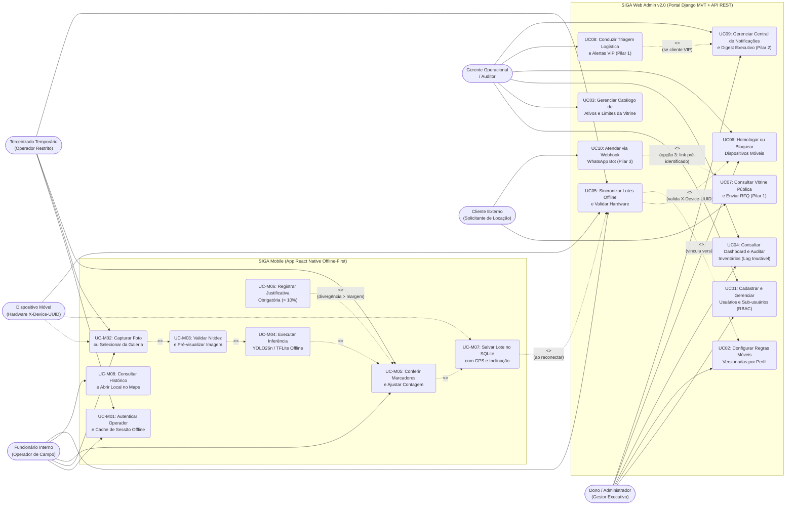

# 2. Diagrama de Caso de Uso — Ecossistema SIGA (Mobile + Web Admin)

Este documento apresenta o **Diagrama de Caso de Uso Geral** integrando o aplicativo móvel offline-first (**SIGA Mobile**) e a plataforma administrativa corporativa (**SIGA Web Admin v2.0**), seguido da matriz de rastreabilidade entre atores, casos de uso, histórias de usuário (`US`), requisitos (`RF`) e regras de negócio (`RN`).

---

## 2.1 Diagrama de Caso de Uso (Mermaid)

> **Nota de Herança de Papéis:** Em campo, tanto o **Funcionário Interno** quanto o **Terceirizado Temporário** atuam como *Operadores Móveis*, sendo diferenciados pelas políticas de conferência configuradas no `UC02` (limite padrão de `20%` para Funcionários e `5%` para Terceirizados) e pelas permissões de acesso ao histórico no aplicativo (`US-27`). No portal administrativo, o **Dono / Administrador** concentra as decisões estratégicas de empresa e regras, enquanto o **Gerente Operacional** executa a auditoria diária, o catálogo de ativos e a triagem logística.

---

## 2.2 Matriz de Rastreabilidade dos Casos de Uso

| ID | Caso de Uso | Subsistema | Atores Envolvidos | Histórias / Requisitos Associados | Regras de Negócio |
| :--- | :--- | :--- | :--- | :--- | :--- |
| **UC-M01** | Autenticar Operador e Sessão | Mobile / API | Funcionário, Terceirizado | `US-26`, `US-27`, `US-28`, `RF-MOB-07` | `RN-01` (RBAC), `RN-06` (Device Check) |
| **UC-M02 / UC-M03** | Capturar Foto, Galeria e Validar Nitidez | Mobile | Operador, Hardware (Câmera/Sensores) | `US-06`, `US-07`, `US-08`, `RF-MOB-01` | Padrão angular e prevenção de foto borrada |
| **UC-M04** | Executar Inferência YOLO26n Offline | Mobile | Operador (via App) | `US-09` a `US-13`, `RF-MOB-02`, `RF-MOB-03` | `RNF-MOB-01` (100% Offline), `RNF-MOB-03` ($\text{MAPE} \le 10\%$) |
| **UC-M05 / UC-M06** | Conferir, Ajustar e Justificar Divergência | Mobile | Operador | `US-14` a `US-17`, `RF-MOB-04`, `RF-MOB-05` | `RN-03` (Justificativa obrigatória $> 10\%$) |
| **UC-M07 / UC-M08** | Persistir SQLite com GPS e Consultar Histórico | Mobile | Funcionário, Terceirizado (sem histórico) | `US-22` a `US-25`, `RF-MOB-06` | `RNF-MOB-01` (Offline-First) |
| **UC01** | Cadastrar e Gerenciar Usuários e Sub-usuários | Web Admin | Dono / Admin, Gerente | `RF001` | `RN-01` (RBAC), `RN-02` (CPF/E-mail únicos) |
| **UC02** | Configurar Regras Móveis Versionadas | Web Admin | Dono / Admin | `RF002` | `RN-03` (Limites diferenciados), `RN-08` (Versionamento) |
| **UC03** | Gerenciar Catálogo de Ativos e Classes | Web Admin | Gerente Operacional | `RF003` | `RN-04` (Padronização de catálogo e `codigo_yolo`) |
| **UC04** | Consultar Dashboard e Auditar Inventários | Web Admin | Dono / Admin, Gerente / Auditor | `RF004`, `RF005` | `RN-05` (Trilha imutável `LogAuditoria`) |
| **UC05 / UC06** | Sincronizar Inventários e Homologar Dispositivos | Mobile $\leftrightarrow$ API/Web | Operador, Hardware, Gestor | `RF006`, `RNF-WEB-03` | `RN-06` (1º Autorizado, 2º+ Pendente), `RN-07` (Idempotência) |
| **UC07 / UC08** | Vitrine Pública RFQ e Triagem Logística | Web Admin (Pilar 1) | Cliente Externo, Gerente | `RF007` (Pilar 1) | Validação de limites de estoque e antecedência mínima; `HistoricoEvento` |
| **UC09** | Central de Notificações e Digest Executivo | Web Admin (Pilar 2 & 4) | Dono / Admin, Gerente | `RF007` (Pilares 2 e 4) | Filtro anti-ruído (Digest) e trilha `HistoricoEvento` |
| **UC10** | Atendimento Automático Webhook WhatsApp | API Web (Pilar 3) | Cliente Externo | `RF007` (Pilar 3) | Menu 3 opções e auditoria de interações em `HistoricoEvento` |
